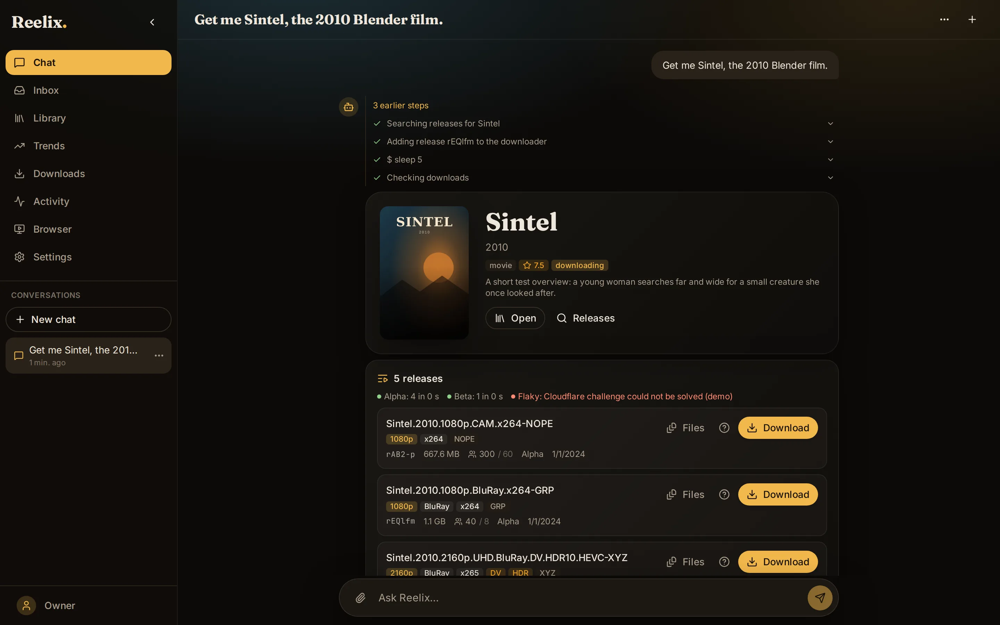
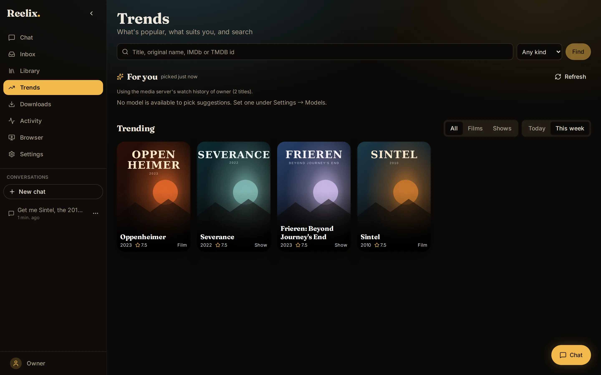
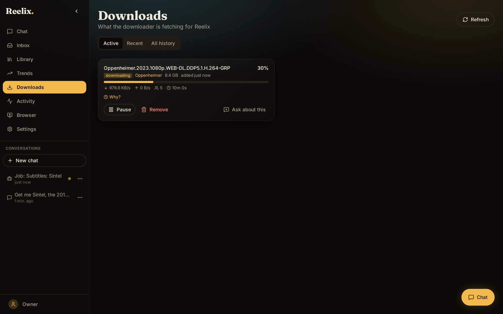
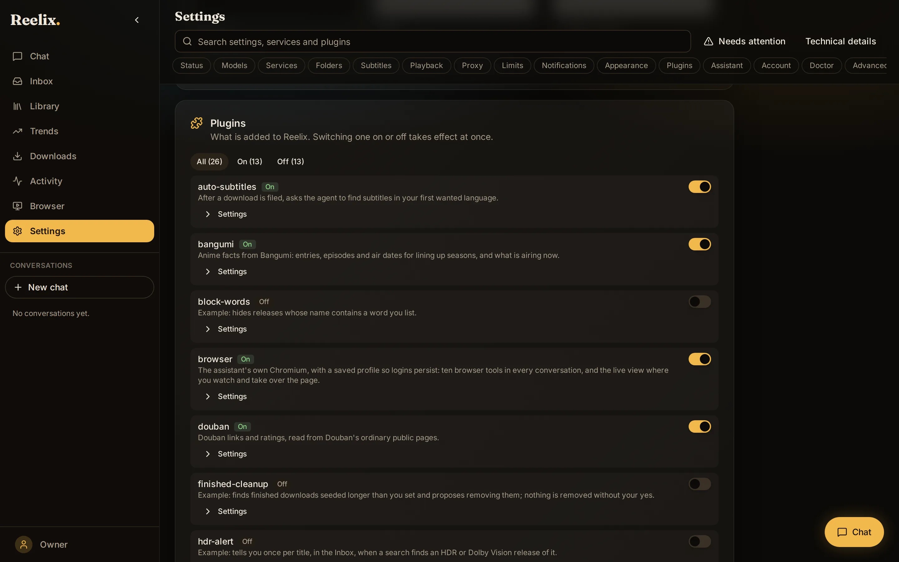
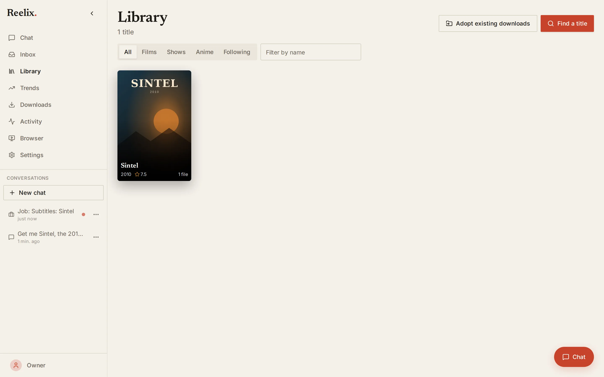

<div align="center">

# Reelix

**An agent-native copilot for your movie, TV and anime collection.**

You talk to it. It finds the title, picks a release, downloads it, files it into your library and fetches the subtitles.

[](LICENSE)


-7cc4e0)

[Introduction](#introduction) · [Features](#features) · [Quick start](#quick-start) · [Plugins](#plugins) · [Documentation](#documentation) · [Contributing](#contributing)

English · 简体中文 · Français · Русский in the app



</div>

## Introduction

Reelix is a self-hosted assistant for one person's media collection on a NAS. It sits beside the tools you already run (qBittorrent, Jackett, Jellyfin) and does the work between them:

1. **Identify** a title from anything: a name, a TMDB or Douban link, a magnet, a screenshot of a poster.
2. **Search** releases and choose one, guided by a plain-text note of your taste.
3. **Download** with qBittorrent. Files stay where they are and keep seeding.
4. **Organise** finished files into a Jellyfin-standard library by hard link, so nothing is copied or moved.
5. **Subtitle**: find, check, clean up and place subtitles, or translate one when none exists.
6. **Follow** a show and fetch new episodes as they air.

Most tools in this space are rule systems with a chat box added. Reelix is the other way round: it is built around the [pi](https://github.com/earendil-works/pi) agent, and the agent is the product.

- **The agent works on the real system.** It has a shell and file access inside its container, so it can look at a messy download and fix it without anyone having written a tool for that case.
- **Judgement replaces rule systems.** Reading an odd release name, deciding which title a release belongs to, choosing between releases: these go to the model. Exact code is kept where a mistake costs something: links, names, download calls, money spent.
- **One operation, three faces.** Every function is defined once and is reachable as an agent tool, a `reelix` command and a web UI action. All three leave the same record in one ledger.
- **Text from outside is data.** Release names, web pages and subtitle contents are marked as outside text and never treated as instructions.

> [!NOTE]
> Reelix is pre-release software. It is developed and tested against fake and real services on a development machine and in a container; it has not yet had a long run on a NAS. Expect changes, including to the plugin API (`api: 0`).

## Features

| | |
| --- | --- |
| **Chat that does the work** | Web, terminal (`reelix chat`) and Telegram. Each step the agent takes is shown and recorded. |
| **Hard-link library** | Movies, shows and anime in Jellyfin's layout. Removal is safe: a last copy goes to a 14-day trash. |
| **Subtitles** | Sources are searched and the content of each file is checked, not just its name. Missing languages can be translated by your own models into a separate styled file. |
| **Trends and suggestions** | TMDB trending, anime airing now from Bangumi, and suggestions from your Jellyfin watch history. |
| **Inbox and approvals** | Questions, plans and notices wait in one place. Destructive actions need your yes, and an approval is used once. |
| **Background jobs** | A job runner, a completion watcher, a nightly tidy-up and a morning summary, under a spending cap. |
| **Notifications** | Web Push from the installable web app, and a Telegram bot you can answer from anywhere. |
| **A browser of its own** | The agent has a Chromium with a live view, for sites that need a person to sign in. |
| **Plugins** | Indexers, subtitle sources, downloaders, notifiers, chat channels and more. 13 built in, 13 examples, and the agent can write one for you. |
| **Themes and languages** | Two themes (Marquee, Paper) and your own as a folder. English, 简体中文, Français, Русский everywhere. |
| **Any model** | Every model is reached through pi. Roles with fallback, and an optional [magpie](https://github.com/yetone/magpie) gateway. |

<p align="center">
 
 
</p>

## How it works

```
┌─────────────────────────── Reelix container ───────────────────────────┐
│                                                                        │
│  Web UI  ◄── HTTP + event stream ──►  Server                           │
│                                         │                              │
│              ┌──────────────────────────┼──────────────────────┐       │
│              │                          │                      │       │
│      pi sessions (agent)        Operations (core)         Job runner   │
│   chat threads and jobs:      one registry, three faces   + watcher    │
│   shell + files + tools                 │                 + plugins    │
│              │                   SQLite, config,                       │
│        `reelix` CLI              notes, ledger                         │
└───────┬───────────────────────┬─────────────────────────┬──────────────┘
        │ /media (one mount)    │ /data (Reelix's own)    │ network
   downloads + library      config, db, notes,       qBittorrent, Jackett, Jellyfin,
                            plugins, sessions        TMDB, Bangumi, subtitle sites,
                                                     model provider, Telegram
```

Downloads and the library sit under **one** mount, because hard links do not cross mount points. The pre-flight script checks this on your NAS before anything is installed.

## Quick start

### On a NAS, with Docker Compose

```sh
git clone https://github.com/4444zyf/Reelix.git && cd Reelix
sudo bash preflight/reelix-preflight.sh   # finds your qBittorrent, Jackett and Jellyfin, tests hard links, prints a .env
cp .env.example .env                      # then put in what the pre-flight printed
docker compose up -d                      # Reelix is at http://<nas>:7878; the first visit sets the password
docker compose exec reelix pi             # sign in to a model provider
```

`COMPOSE_PROFILES` in `.env` switches on the services you do not already run (`magpie`, `qbittorrent`, `jackett`, `jellyfin`); each runs in its own container. Inside the containers, services reach each other by name (`http://qbittorrent:8080`), never `localhost`. No image is published yet: the NAS builds Reelix from the repository. Details are in [docs/deployment.md](docs/deployment.md).

### From source

Requirements: Node ≥ 22.18. TypeScript runs directly; the backend has no build step.

```sh
npm install
npm run web:build                      # static UI into packages/web/dist
export REELIX_DATA=$PWD/.dev-data      # /data in the container
export REELIX_PI_DIR=~/.pi/agent       # pi's sign-in and models (default: $REELIX_DATA/pi)
bin/reelix config set models.roles.chat provider/model-id
bin/reelix serve                       # web UI on :7878
```

### Try it without any services

```sh
REELIX_DATA=/tmp/reelix-try REELIX_PI_DIR=~/.pi/agent REELIX_DEMO_PASSWORD=choose-one \
  REELIX_DEMO_MODEL=provider/model-id node --no-warnings --disable-sigusr1 scripts/demo.ts
```

This starts Reelix against fake qBittorrent, Jackett, TMDB, Jellyfin and Bangumi, with downloads that "finish" after about 30 seconds. Only the agent is real.

## Usage

```sh
bin/reelix chat                        # the agent in the terminal
bin/reelix help                        # every operation, generated from the registry
bin/reelix plugin list                 # what is installed and switched on
```

In chat, say what you want:

> Get me Sintel, the 2010 Blender film.
> Follow Frieren and keep the Chinese subtitles.
> Why did last night's download end up in the wrong folder? Fix it.

> [!IMPORTANT]
> Always start Reelix through `bin/reelix`, `npm run server` or the container. They start Node with `--disable-sigusr1`; without it, a `SIGUSR1` signal opens Node's debugger on 127.0.0.1:9229 for anyone on the machine ([docs/plugins.md](docs/plugins.md) §11.7).

## Plugins

Almost everything that talks to an outside service is a plugin, including the built-in ones: `qbittorrent`, `jellyfin`, `jackett`, `subtitle-sites`, `bangumi`, `douban`, `telegram`, `push`, `players`, `browser`, `model-translator`, `auto-subtitles` and `metadata-refresh`. A plugin can:

- **fill a seam**: be an indexer, a subtitle source, a downloader, a media server, a notifier, a chat channel, a metadata source, a translator, a player or a trends source;
- **join a hook**: filter or rank releases, change how files are named, guard a download, add to the agent's prompt, give the agent a tool;
- **add operations** with a declared effect (read, write, destructive, admin), **a screen** in the web UI, or **a skill pack**.

```sh
bin/reelix plugin new ~/reelix-plugins/my-plugin     # asks the kind and the id; writes a working plugin with tests
bin/reelix plugin check ~/reelix-plugins/my-plugin   # the checker and the seam's conformance suite; no server needed
bin/reelix plugin dev ~/reelix-plugins/my-plugin     # a Reelix with fake services and the plugin loaded
```

Start with the [plugin guide](docs/plugin-guide.md); every seam, hook, event and context call is in the generated [reference](docs/plugin-reference.md). `plugins/examples/` holds thirteen small examples (twelve plugins and a skill pack), off until you switch them on. Plugins install from a folder, a git commit or an exact npm version, with `reelix plugin add` or in Settings → Plugins.

A plugin that runs in the server process is trusted like Reelix itself. The separate-process runtime narrows what a plugin can reach, but it is not a hard security boundary on its own; read [docs/plugins.md](docs/plugins.md) §11 before installing code you have not read.

## Documentation

| Document | What it covers |
| --- | --- |
| [Design](docs/2026-11-17-reelix-design.md) | What Reelix is, its principles, architecture and safety rules. |
| [Deployment](docs/deployment.md) | Docker Compose, services, users and files, pre-flight. |
| [Plugins: design](docs/plugins.md) | Seams, hooks, effects, trust, distribution. |
| [Plugins: guide](docs/plugin-guide.md) · [reference](docs/plugin-reference.md) | Writing a plugin, with recipes; everything a plugin can use. |
| [Web API](docs/api.md) | The HTTP API behind the web UI. |
| [Models](docs/models.md) · [magpie](docs/magpie.md) | Roles, fallback, and the optional gateway. |
| [Subtitle translation](docs/subtitle-translation.md) | When and how a subtitle is translated. |
| [Trends](docs/trends.md) | Trending, suggestions and paths on screen. |
| [Web app](docs/web-app.md) | Installing the web app and native notifications. |
| [Themes](docs/ui-themes.md) · [Languages](docs/i18n.md) | Making a theme; how the four languages work. |

## Project layout

| Path | What |
| --- | --- |
| `packages/core` | The operation registry and ledger, seams and hooks, organiser, titles, downloads, library, subtitles, follows, doctor. No agent, no HTTP. |
| `packages/server` | HTTP API, the private local socket, the pi host (sessions, tools), job runner, completion watcher, plugin kernel, nightly tidy-up. |
| `packages/cli` | The `reelix` command, generated from the registry, and the plugin author's `new`, `check` and `dev`. |
| `packages/web` | The web UI (Astro + React). |
| `packages/plugin` · `packages/plugin-testing` | `@reelix/plugin`, what a plugin imports, and the tools to test one. |
| `plugins/` | Built-in plugins; `plugins/examples/` holds reference plugins and a skill pack. |
| `skills/` · `themes/` | Built-in agent skills and UI themes. |
| `preflight/` · `docker/` | The NAS pre-flight check and the container entrypoint. |
| `website/` | The project website (`website/README.md`). |

## Development

```sh
npm run typecheck
npm test            # core, server and plugins against fake qBittorrent, Jackett, TMDB and Jellyfin; locale checks
npm run web:dev     # the web UI with hot reload
REELIX_PI_DIR=~/.pi/agent REELIX_TEST_MODEL=provider/model node --no-warnings packages/server/test/agent.e2e.ts   # agent behaviour; spends tokens
```

## Status and roadmap

- **Built:** the media loop (identify, search, download, organise, subtitles), follows, adoption of existing downloads, the web UI and installable web app, Telegram, background jobs, trends, subtitle translation, the plugin system with its process runtime and separate system users in the container.
- **Next:** a long run on a real NAS under Compose; the owner's review of the plugin API before it is declared `api: 1`.
- **Reserved, not built:** a plugin index, published images and packages, an MCP plugin runtime, standing approvals.

## Contributing

Contributions are welcome, and a plugin is the easiest way in: it needs no knowledge of Reelix's code. For changes to Reelix itself, the rules are short and in [CLAUDE.md](CLAUDE.md):

- **Docs first.** A design is written into `docs/` and agreed before it is coded.
- **No dead code.** When a change makes code unused, it goes in the same change.
- **Four languages.** Every user-visible string exists in en, zh, fr and ru.
- **Checks.** `npm run typecheck` and `npm test` pass before work is called done.

Please report security problems privately to the maintainer, not in a public issue.

## Acknowledgements

- [pi](https://github.com/earendil-works/pi), the agent Reelix is built around.
- [MoviePilot](https://github.com/jxxghp/MoviePilot), the main reference for what goes wrong in this domain. Reelix contains no code, tests or fixtures from it (it is GPL-3.0).
- [Cordis](https://github.com/cordiverse/cordis), whose scopes and undo steps shaped the plugin kernel.
- qBittorrent, Jackett, Jellyfin, TMDB and Bangumi, the services Reelix works with.

## Licence

[MIT](LICENSE) © 2026 4444zyf
